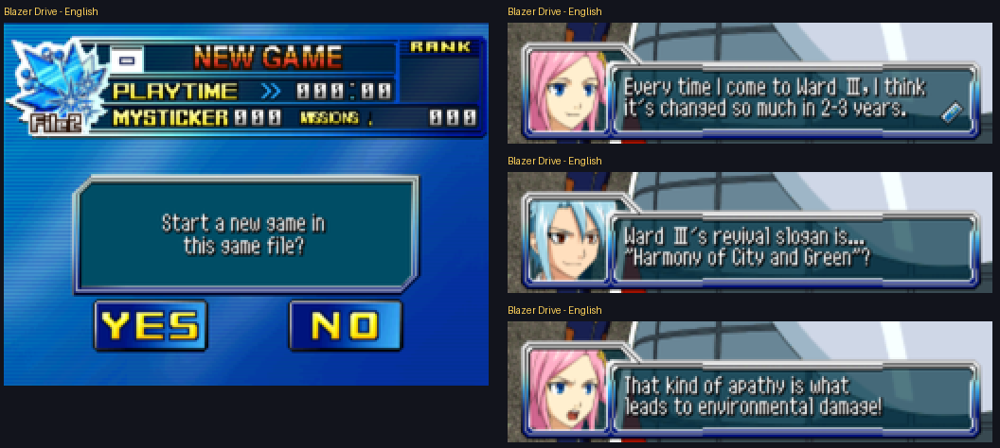

# Blazer Drive — English Fan Translation Toolkit (Nintendo DS)

[](https://ko-fi.com/rafadono)

**Blazer Drive** (SEGA, 2008) is a Japan-only Nintendo DS RPG built around
collectible MYSTICKERs. This repository contains a reproducible toolkit that translates the
whole game script into English and rebuilds a playable ROM. It is verified on a real
emulator, with screenshots taken from the game.

<p align="center">
  
</p>

> Real captures from DeSmuME running the rebuilt English ROM (file-select screen and
> prologue dialogue).

## Status

| Area | State |
|---|---|
| Game script (19,826 strings in 136 message files) | ✅ Translated, validated and injected |
| Boot, intro, new game, prologue, tutorial | ✅ Verified in the emulator |
| Dialogue fitting | ✅ Variable-width font + automatic pagination; no box overflows |
| File-select / save screen graphics | ✅ Redrawn in English |
| Other menu and battle graphics (867 texture files) | 🚧 Tooling ready, art not yet redrawn |
| Full playthrough to the ending | 🚧 In progress (emulator QA with save-state checkpoints) |

## Highlights

* **Exact text extraction.** A byte-exact parser for the game's `MPCT` message format
  replaces the old heuristic scanner, which mistook ARM code for text and broke the boot.
* **Strings can grow.** Messages are rebuilt instead of patched in place, so English is
  never truncated.
* **Safe CPK repacking.** Modified files are appended and the CRIWARE TOC is patched in
  place. CriPakTools corrupts these archives.
* **Variable-width font.** The ASCII half of the game font is converted to a VWF, which
  fits 25–30 % more text per line.
* **Validated injection.** Colour codes, `printf` arguments and custom icon glyphs are
  checked on every line. Password puzzles keep the katakana answers that the game
  scripts compare against.
* **Texture text redraw.** Japanese labels inside DS 3D textures are redrawn in English,
  using only the original palette and style.
* **Real-emulator QA.** DeSmuME is driven by input movies and save-state checkpoints;
  screenshots are taken from the emulator window.

## Quick start

Requirements: Windows (for the emulator QA), [uv](https://docs.astral.sh/uv/), and your own
dump of the Japanese ROM (not included).

```bash
uv sync
# put your own dump of the Japanese ROM at: rom/blazer_drive_jp.nds
make unpack     # extract the ROM (reference copy in workspace/)
make all        # inject text + redraw graphics + build -> rom/blazer_drive_translated.nds
make test       # unit tests
```

Optional emulator QA (see [docs/QA.md](docs/QA.md)):

```bash
make emulators        # portable DeSmuME into tools/emulators/
make qa-checkpoints   # save states for the current build
make qa-dialogs       # step through the prologue and collect dialogue screenshots
make showcase         # regenerate the comparison images above
```

## Translation workflow

```bash
make extract          # local catalogue from YOUR ROM + the published English -> workspace/catalog/
make batches          # JSON batches for translators -> workspace/batches/in/
make import-batches   # validate batches, merge them and refresh translations/strings_en.csv
```

The repository publishes **only English**: `translations/strings_en.csv` (IDs, offsets and
English lines) and `translations/overrides_en.json`. The Japanese source text is read from
your own ROM at build time and stays in the git-ignored `workspace/`. Rules and canonical
names for translators are in [translations/STYLE_GUIDE.md](translations/STYLE_GUIDE.md).

## Repository layout

```text
blazer_drive/      Python package and CLI (python -m blazer_drive --help)
  cpk.py           CRIWARE CPK reader + safe repacker
  bmsg.py          MPCT message format (read/rebuild)
  sbd.py           DS texture containers (.sbd)
  gfx_text.py      redraw English text inside textures
  font.py          glyph metrics; font_patch.py builds the VWF
  catalog.py       translation catalogue (CSV/XLSX)
  injector.py      validated injection, line fitting and pagination
  rom.py           pristine files from the original ROM + ROM rebuild
  batches.py       translation batches export/import
  gfx_patches.py   list of texture text patches
qa/                emulator QA: harness (DeSmuME control, input movies) and scenarios
tests/             unit tests (python -m unittest)
translations/      English lines, password overrides, style guide (no Japanese text)
docs/              FORMATS.md (reverse-engineered formats), QA.md, images/
tools/             download_emulators.py
```

## Documentation

* [docs/FORMATS.md](docs/FORMATS.md): CPK, MPCT, NFTR font, DS textures, custom glyphs and
  event passwords.
* [docs/QA.md](docs/QA.md): how the emulator QA works, and the findings it verified.
* [docs/GRAPHICS_PLAN.md](docs/GRAPHICS_PLAN.md): inventory of the graphics that still contain Japanese text, and the plan to translate them.

## Support

If this project is useful to you, you can support my time and tooling on
[Ko-fi](https://ko-fi.com/rafadono). Donations are completely voluntary: the toolkit and
the translation are, and will always be, free.

## License and legal

The source code and documentation are released under the [MIT License](LICENSE).
The license does not cover Blazer Drive or any of its contents (program, script,
graphics, names and trademarks belong to SEGA, Kodansha and the original authors).

This is an unofficial fan project, not affiliated with SEGA or Kodansha. Nothing is
sold: donations only support the author's time and never unlock any content.
No ROM, BIOS or emulator binaries are distributed, and the repository stores no Japanese
game text. You need your own legally obtained copy of the game.
